# Eternal Sunset — shader pack

Shader pack for the **Eternal Sunset** modpack: **Minecraft 1.20.1 Forge + Oculus** (Iris-compatible).
Setting: a solar catastrophe. The sun froze on the horizon, bloated and bleeding. Everything away
from it drowns in ash and darkness, and the darkness gnaws at the player's mind.

All screenshots are real in-game captures (Forge 1.20.1 + Oculus 1.8.0 + Embeddium, software rendering).

| | |
|---|---|
| 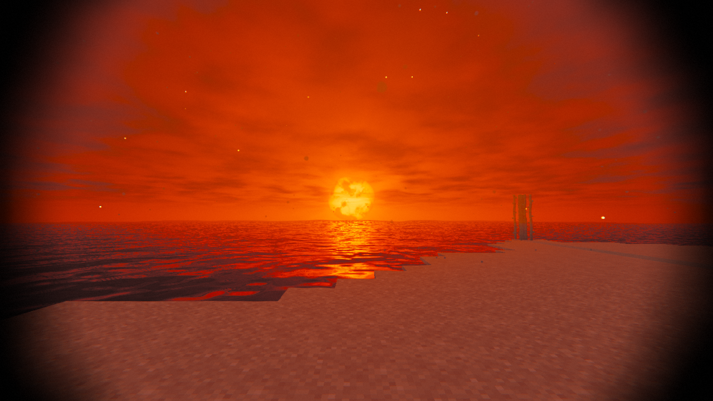 Blood sea under the dead sun | 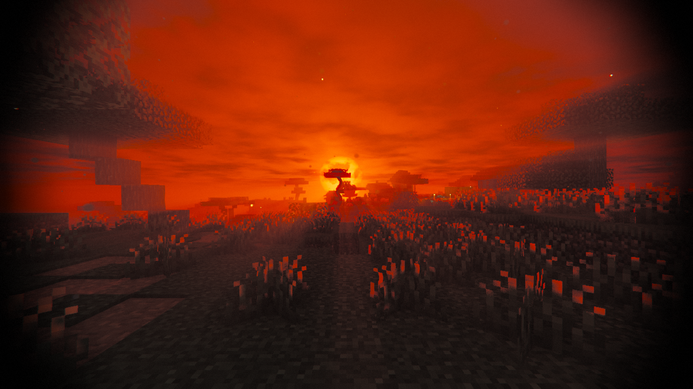 Forest silhouettes, god rays |
| 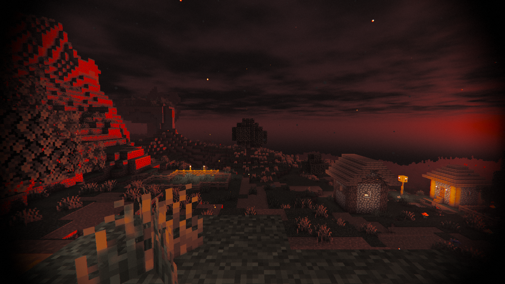 Village away from the sun | 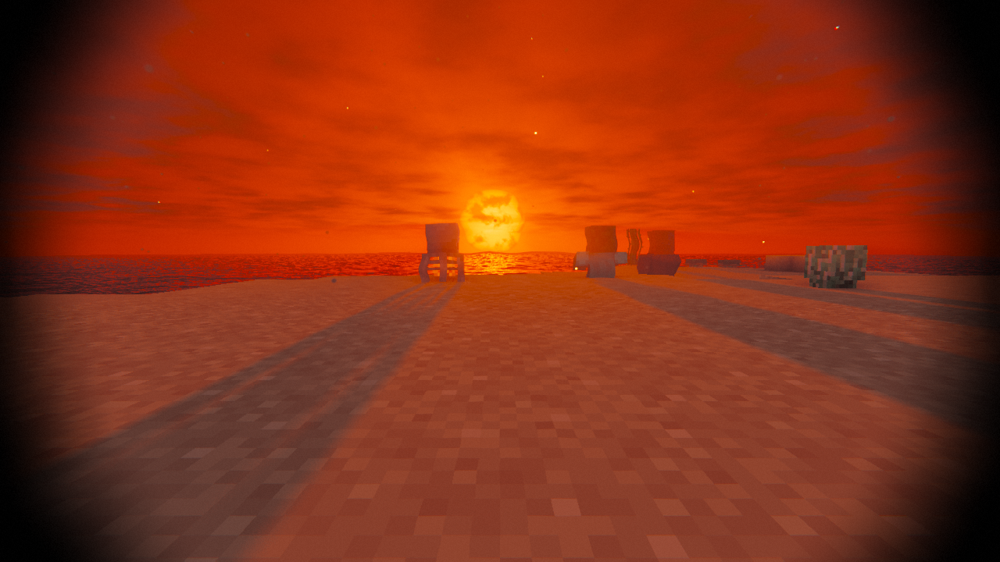 Mobs cast long shadows |
| 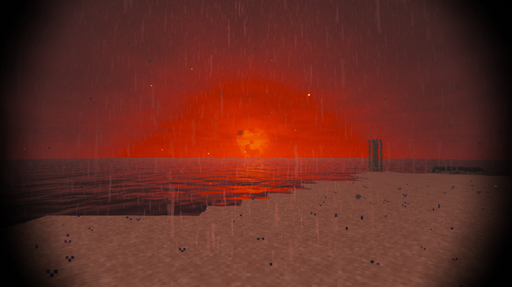 Ash rain swallows the sun | 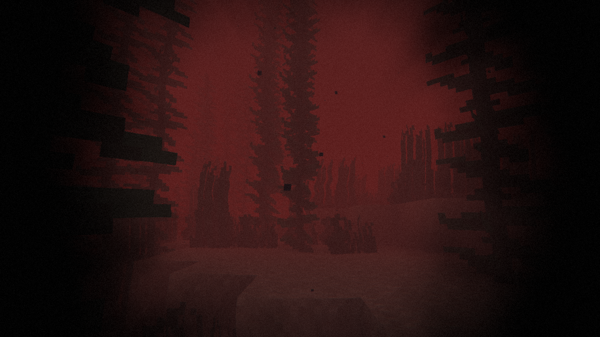 Under the blood |
| 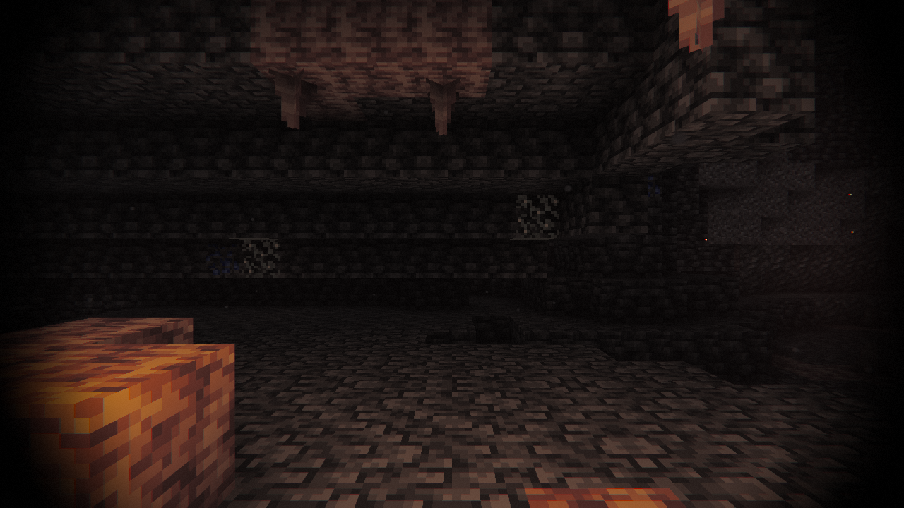 Cave, torch in hand | 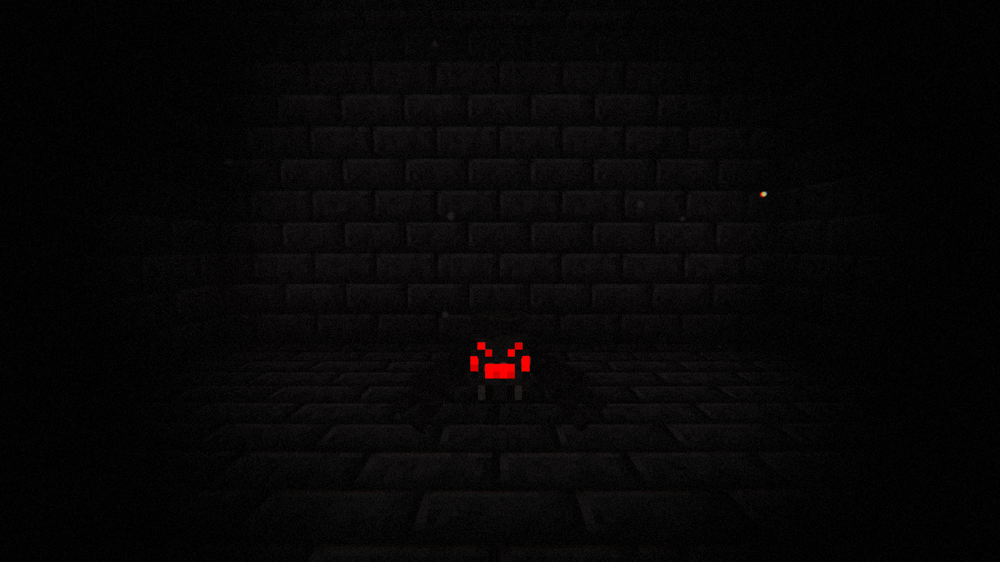 Total darkness |
| 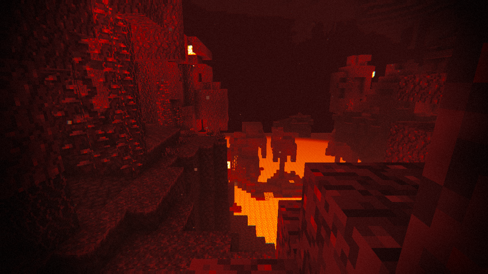 Nether | 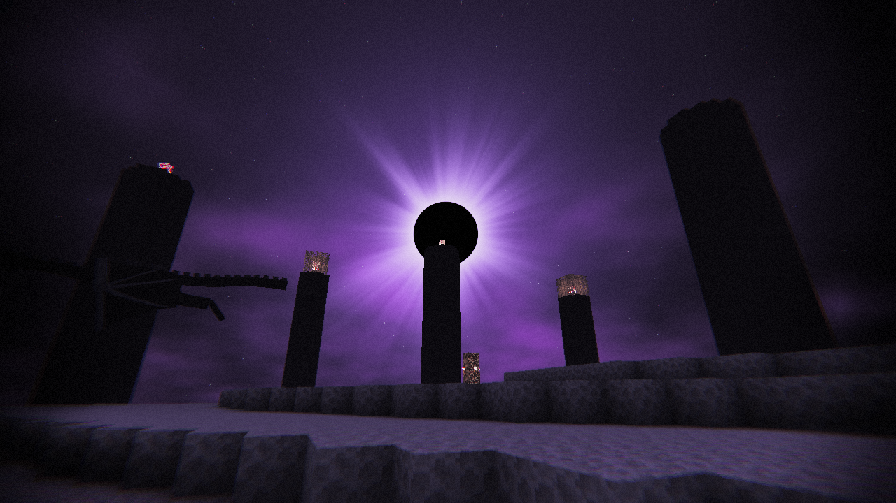 The End: eclipsed sun |
| 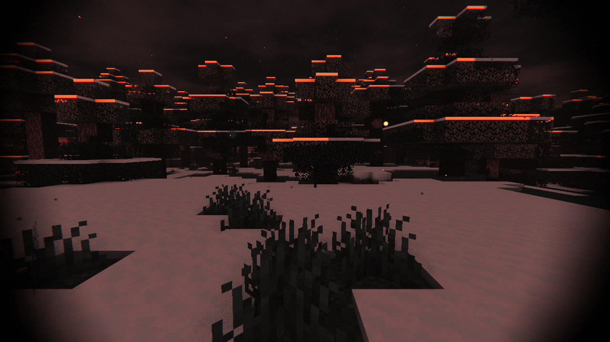 Ash snow | 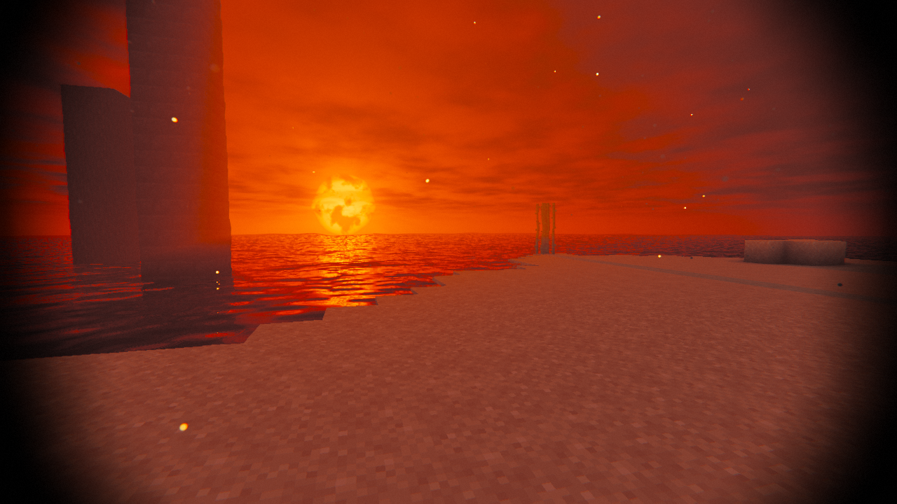 Ruins mirrored in the blood sea |
| 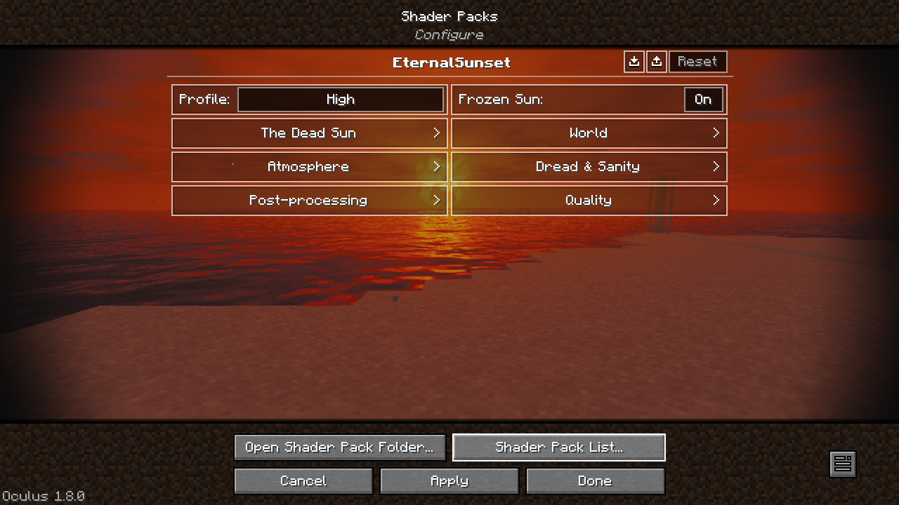 Settings (EN/RU) | |

## Features
**The dead sun**
- `FROZEN_SUN`: sky and light always come from a sun pinned near the horizon, regardless of game time
- Huge blood-red disk with sunspots, limb darkening and a writhing corona; heat haze; screen-space god rays
- If the modpack does not freeze time, shadows from the "real" sun fade out instead of mismatching

**World**
- Black ash sky with drifting clouds lit red only toward the sun; optional drifting ash and embers
  (off by default)
- Gloom under tree crowns: forests are starved of light, open fields unchanged (`CANOPY_DARKNESS`)
- Blood / black oil / rusty ash water (`WATER_STYLE`) with slow viscous waves, a sun path
  on the surface and screen-space reflections of shores and ruins
- Long red shadows (soft Vogel filter), SSAO, near-zero ambient: torches are the only refuge
- Torch in hand lights the world around you; glowing blocks, lava, spider/enderman eyes
- Grass and leaves tremble in the hot wind (shadows follow); thin foliage glows when backlit
- Colour drains from the world except red

**Every situation**
- Nether: lava-lit ambient, smouldering haze, embers; End: void sky with an eclipsed black sun
- Underwater (blood murk), in lava, in powder snow, Blindness / Darkness effects, Night Vision
- Rain and snow as translucent ash sheets; overcast swallows the sun, fog thickens
- Hand, glass, block entities, particles, enchantment glint, entity hurt flash handled separately

**Dread system** — driven by light around the player (sky, nearby torches, torch in hand), by how
dark the picture actually is (shadows, dense forest, the side away from the sun) and by the vanilla
Darkness effect. Each part of the screen edge darkens by how dark that part of the picture is:
- in light: only thin ragged dark strips on the screen sides
- in darkness: the void creeps in from every edge toward the centre, pulsing with a heartbeat;
  breathing lens, chromatic aberration, heavier grain, rare flicker

**Settings** — profiles Low / Medium / High / Ultra, all options named in English and Russian.

## Modpack integration
- Freeze time so shadows match the frozen sun: `/gamerule doDaylightCycle false`, `/time set 12600`
  (KubeJS on world load, or a default-gamerules mod).
- Sanity hook: give the player the vanilla **Darkness** effect when sanity is low — the shader reads
  `darknessFactor` and the dread effects grow.

## Install
Download `dist/EternalSunset.zip` (or zip the `shaders/` folder yourself so `shaders/` is at the
zip root) → `.minecraft/shaderpacks/`. Requires Oculus + Embeddium on Forge 1.20.1.

## Layout
- `shaders/program/` — program bodies; `shaders/lib/` — shared code
- `shaders/*.vsh|fsh`, `shaders/world-1/`, `shaders/world1/` — tiny per-dimension wrappers,
  generated by `tools/gen_wrappers.py` (run it after adding a program)
- `shaders/block.properties` — material ids (water, plants, leaves, glowing blocks, lava)

## Dev tools
- `tools/validate.sh` — compile every program of every dimension with glslangValidator
- `tools/ingame-test.sh` — real in-game test on llvmpipe; `reload` after edits (prints load errors),
  `shot out.png "~ ~ ~ yaw pitch"` for a screenshot
- `node tools/preview.js out.png [dread] [yaw]` — quick headless preview of sky + grading
