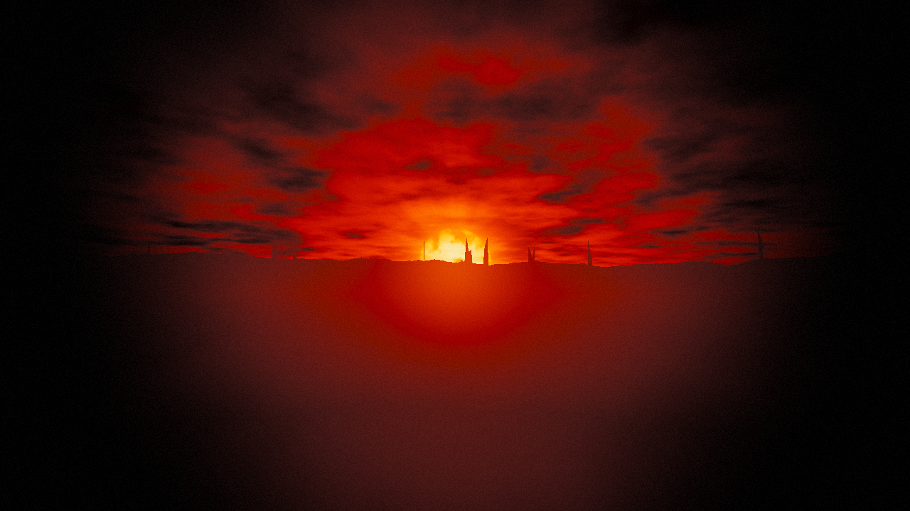
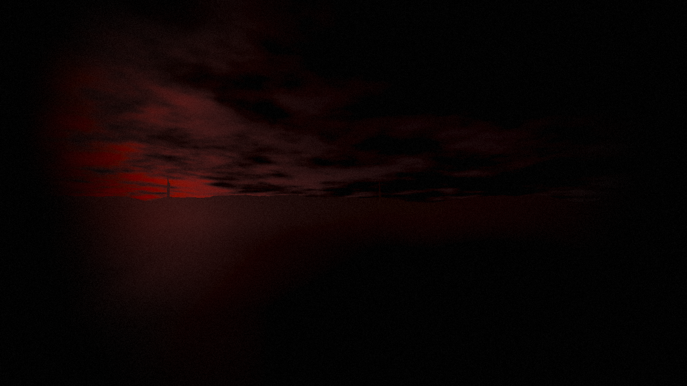

# Eternal Sunset — shader pack

Shader pack for the **Eternal Sunset** modpack: **Minecraft 1.20.1 Forge + Oculus** (also Iris-compatible).
Setting: a solar catastrophe. The sun froze on the horizon, bloated and bleeding. Everything away from it drowns in ash and darkness.

*(Previews: real sky + grading code rendered via WebGL with fake terrain; in-game will differ.)*

## Features
- **Frozen sun** (`FROZEN_SUN`): sky and light always come from a dying sun pinned near the horizon, regardless of game time
- Huge blood-red sun: sunspots, limb darkening, writhing corona/flares
- Ash clouds drifting across a black sky, rims lit red only near the sun
- Long red shadows, near-zero ambient; torches are the only refuge (small radius, flicker)
- Choking ash fog: smoldering red toward the sun, black everywhere else
- Screen-space god rays from the sun
- **Dread system**: grows in darkness (no sky light) and under the vanilla Darkness effect
  - creeping darkness tendrils at the screen edges, pulsing with a heartbeat
  - breathing lens distortion, chromatic aberration, film grain, rare flicker
- Heat haze boiling around the sun, bloom, ACES + grading that bleeds all colour except red

## Modpack integration (important)
- Freeze time so shadows match the frozen sun: `/gamerule doDaylightCycle false` and `/time set 12600`
  (via KubeJS on world load, or a default-gamerules mod).
- Sanity hook: give the player the vanilla **Darkness** effect when sanity is low — the shader reads
  `darknessFactor` and amplifies the dread effects.

## Install
Zip the `shaders/` folder (so `shaders/` is at the zip root) → `.minecraft/shaderpacks/`.

## Dev tools
- `tools/validate.sh` — compile every program with glslangValidator
- `node tools/preview.js out.png [dread] [yaw]` — headless preview of sky + grading
